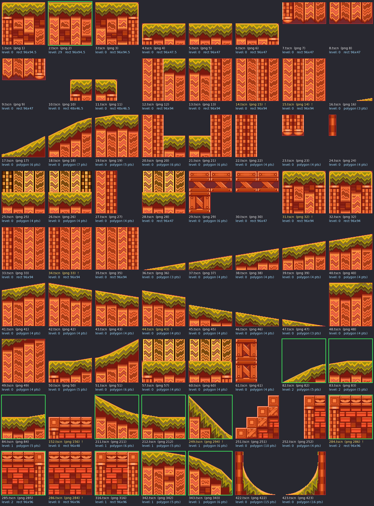

# Ground pieces (`suelos/`) — organization sheet

How to read `ground-pieces-sheet.png`:
- It shows every scene in `suelos/` drawn at 2x, with its collision in red on top.
- The **green border** marks the 15 pieces the test level uses.
- **Yellow text with "!"** marks the scenes whose number doesn't match the PNG they use.
- "level: N" is how many times the piece appears in `items/checkpoint/Node2D.tscn`.

The sheet is generated by a script that isn't in the repo. If needed, it can be added to `tools/`.

## Problems found

- **Scenes that don't use their own PNG:**
  - `14.tscn` ↔ `15.tscn`: swapped.
  - `284.tscn` ↔ `286.tscn`: swapped.
  - `152.tscn` uses `156.png` and `249.tscn` uses `294.png`.
- **Duplicates (same PNG):** `31` and `32` use `32.png`; `33` and `34` use `33.png`; `43` and `44` use `43.png`.
- **Unused:** 55 of the 70 scenes don't appear in the level. 634 of the 704 PNGs in
  `Sprites/sunset hill/` aren't used by any scene.
- Almost every piece has its sprite scaled to `0.979` on Y, and its collision scaled to
  `(1.71, 1.23)` with fractional positions. They line up visually, but the numbers are hard
  to maintain. *Hypothesis:* they come from manual adjustments in the editor.

## Surface angles

Angle of the top faces of each collision, computed from the polygon:
**rises** = goes up to the right, **falls** = goes down to the right.
This matters for the SPG slopes phase.

## Table with proposed names

The names were **proposed by Claude** from looking at the sheet; Silv decides.
The scheme is `<material>_<shape>[_<angle>]_<variant>`.

| Scene | PNG | Collision | Surface | Level | Proposed name |
|---|---|---|---|---|---|
| 1 | 1 | rect 96×94.5 | flat | 0 | `grass_block_a` |
| 2 | 2 | rect 96×94.5 | flat | **29** | `grass_block_b` (the common floor) |
| 3 | 3 | rect 96×94.5 | flat | 0 | `grass_block_c` |
| 4 | 4 | rect 96×47.5 | flat | 0 | `grass_half_a` |
| 5 | 5 | rect 96×47 | flat | 0 | `grass_half_b` |
| 6 | 6 | rect 96×47 | flat | 0 | `grass_half_c` |
| 7 | 7 | rect 96×47 | — (underside) | 0 | `under_half_a` |
| 8 | 8 | rect 96×47 | — | 0 | `under_half_b` |
| 9 | 9 | rect 96×47 | — | 0 | `under_half_c` |
| 10 | 10 | rect 48×46.5 | flat | 0 | `grass_small_a` |
| 11 | 11 | rect 48×46.5 | flat | 0 | `grass_small_b` |
| 12 | 12 | rect 96×94 | flat (grass on the right) | 0 | `grass_wall_right` |
| 13 | 13 | rect 96×94 | flat (grass on the left) | 0 | `grass_wall_left` |
| 14 | **15** | rect 96×94 | — (fill) | 0 | `fill_a` |
| 15 | **14** | rect 96×94 | — (fill) | 0 | `fill_b` |
| 16 | 16 | polygon | rises 10° (sliver) | 0 | `slope_up10_sliver` |
| 17 | 17 | polygon | rises 7°→26° (curve) | 0 | `curve_up_low` |
| 18 | 18 | polygon | rises 18°→27° | 0 | `curve_up_high` |
| 19 | 19 | polygon | rises 10°, then flat | 0 | `grass_block_crest` |
| 20 | 20 | polygon | flat (lower step on the right) | 0 | `step_down_right` |
| 21 | 21 | polygon | flat (lower step on the left) | 0 | `step_down_left` |
| 22 | 22 | polygon | flat | 0 | `pillar_wide` |
| 23 | 23 | polygon | flat | 0 | `pillar_short` |
| 24 | 24 | polygon | flat | 0 | `pillar_thin` |
| 25 | 25 | polygon | flat (low grass, background above) | 0 | `grass_low_bg_a` |
| 26 | 26 | polygon | flat (low grass, background above) | 0 | `grass_low_bg_b` |
| 27 | 27 | polygon | flat | 0 | `pillar_tall` |
| 28 | 28 | rect 96×47 | flat (low grass, background above) | 0 | `grass_low_bg_c` |
| 29 | 29 | polygon | flat | 0 | `bridge_girder_corner` |
| 30 | 30 | rect 96×47 | flat | 0 | `bridge_girder` |
| 31 | **32** | rect 96×94 | flat | 0 | duplicate of 32 |
| 32 | 32 | rect 96×94 | flat | 0 | `grass_block_d` |
| 33 | 33 | rect 96×94 | — (fill) | 0 | `fill_c` |
| 34 | **33** | rect 96×94 | — | 0 | duplicate of 33 |
| 35 | 35 | rect 96×94 | — (fill) | 0 | `fill_d` |
| 36 | 36 | polygon | rises 10° | 0 | `slope_up9_1` (continuous ramp 36→41) |
| 37 | 37 | polygon | rises 9° | 0 | `slope_up9_2` |
| 38 | 38 | polygon | rises 9° | 0 | `slope_up9_3` |
| 39 | 39 | polygon | rises 9° | 0 | `slope_up9_4` |
| 40 | 40 | polygon | rises 9° | 0 | `slope_up9_5` |
| 41 | 41 | polygon | rises 9° | 0 | `slope_up9_6` |
| 42 | 42 | polygon | falls 9° | 0 | `slope_down9_1` (continuous ramp 42→47) |
| 43 | 43 | polygon | falls 9° | 0 | `slope_down9_2` |
| 44 | **43** | polygon | falls 9° | 0 | duplicate of 43 |
| 45 | 45 | polygon | falls 9° | 0 | `slope_down9_4` |
| 46 | 46 | polygon | falls 9° | 0 | `slope_down9_5` |
| 47 | 47 | polygon | falls 9° | 0 | `slope_down9_6` |
| 48 | 48 | polygon | flat | 0 | `grass_block_e` |
| 49 | 49 | polygon | flat | 0 | `fill_grass_edge` |
| 50 | 50 | polygon | flat, then rises 9° | 0 | `grass_half_rise` |
| 51 | 51 | polygon | rises 6°→27° (curve) | 0 | `curve_up_mid` |
| 57 | 57 | polygon | flat (low grass, background above) | 0 | `grass_low_bg_d` |
| 60 | 60 | polygon | flat (low grass, background above) | 0 | `grass_low_bg_e` |
| 61 | 61 | polygon | flat | 0 | `crate_column` |
| 82 | 82 | polygon | rises 17°→27° | **2** | `curve_up_start` |
| 83 | 83 | polygon | rises 10°, then flat | **2** | `hill_crest_up` |
| 84 | 84 | polygon | rises 10°, then flat | **1** | `grass_low_rise` |
| 152 | **156** | rect 96×48 | flat | 0 | `brick_half` |
| 211 | 211 | polygon | falls 7°→27° | **1** | `curve_down_high` |
| 212 | 212 | polygon | flat, then falls 10° | **1** | `grass_low_fall` |
| 249 | **294** | polygon | falls 38°→45° | **1** | `slope_down45` |
| 251 | 251 | polygon | steps | 0 | `crate_stairs` |
| 252 | 252 | polygon | flat | 0 | `brick_pillar` |
| 284 | **286** | rect 96×96 | flat | **2** | `brick_block_a` |
| 285 | 285 | rect 96×96 | flat | **2** | `brick_block_b` |
| 286 | **284** | rect 96×96 | flat | 0 | `brick_block_c` |
| 316 | 316 | rect 96×96 | flat | **1** | `brick_block_d` |
| 342 | 342 | polygon | falls 9°, then flat | **1** | `hill_crest_down` |
| 343 | 343 | polygon | falls 20°→45° | **1** | `curve_down_steep` |
| 422 | 422 | polygon (15 pts) | falls 0°→73° | 0 | `loop_quarter_left` (node `LoopShellLeft`) |
| 423 | 423 | polygon (16 pts) | rises 0°→73° | 0 | `loop_quarter_right` (node `LoopShellRight`) |

## Decisions and open questions

- **Decided (2026-11-08):** names in **English**. This file is the reference for the
  reorganization: swapped scenes, duplicates, continuous ramps and proposed names.

Still to decide:

1. Do the 55 unused scenes stay in the project (for future levels) or get archived?
2. For the duplicates (31, 34, 44): delete them or keep them as variants?
