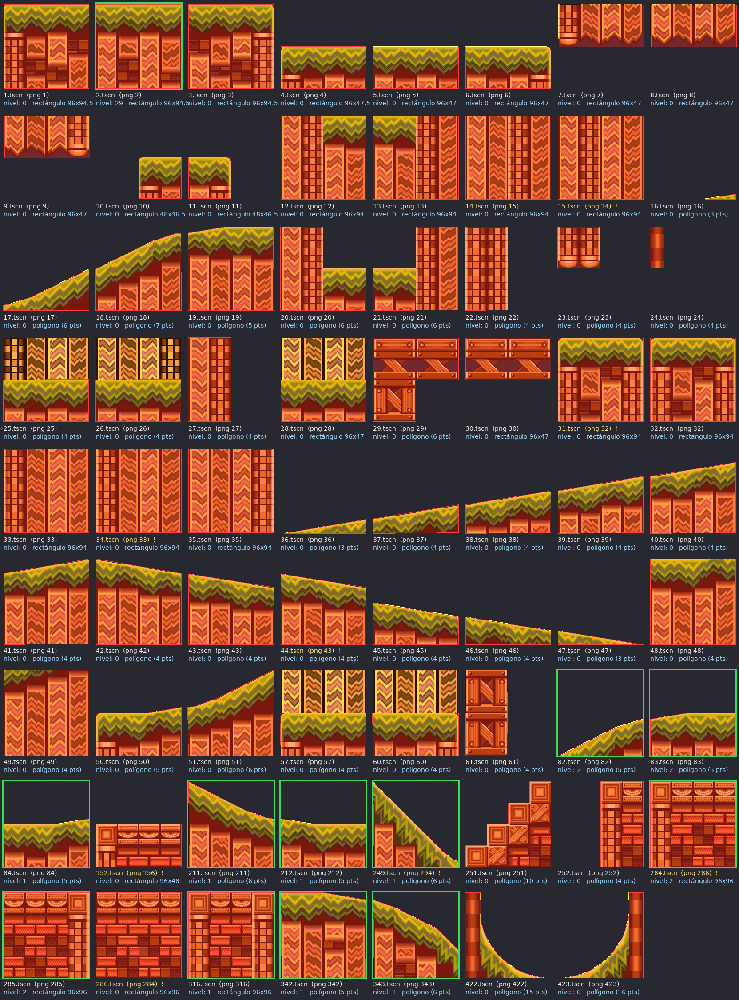

# Piezas de suelo (`suelos/`) — hoja de organización

Cómo leer la hoja `hoja-suelos.png`:
- Muestra cada escena de `suelos/` dibujada a 2x, con su colisión encima en rojo.
- El **borde verde** marca las 15 piezas que usa el nivel de prueba.
- El texto **amarillo con "!"** marca las escenas cuyo número no coincide con el PNG que usan.
- "nivel: N" es cuántas veces aparece la pieza en `items/checkpoint/Node2D.tscn`.

Para regenerar la hoja (por ejemplo, después de cambiar colisiones) se usa un script
de Claude que no está en el repo. Si hace falta, se puede añadir a `tools/`.

## Problemas encontrados

- **Escenas que no usan su propio PNG:**
  - `14.tscn` ↔ `15.tscn`: intercambiados.
  - `284.tscn` ↔ `286.tscn`: intercambiados.
  - `152.tscn` usa `156.png` y `249.tscn` usa `294.png`.
- **Duplicados (mismo PNG):** `31` y `32` usan `32.png`; `33` y `34` usan `33.png`; `43` y `44` usan `43.png`.
- **Sin uso:** 55 de las 70 escenas no aparecen en el nivel. 634 de los 704 PNG de
  `Sprites/sunset hill/` no los usa ninguna escena.
- Casi todas las piezas tienen el sprite escalado a `0.979` en Y, y la colisión con
  escala `(1.71, 1.23)` y posiciones decimales. Visualmente cuadran, pero son números
  difíciles de mantener. *Hipótesis:* vienen de ajustes a mano en el editor.

## Ángulos de superficie

Ángulo de las caras de arriba de cada colisión, calculado del polígono:
**sube** = sube hacia la derecha, **baja** = baja hacia la derecha.
Importa para la fase de pendientes de la SPG.

## Tabla con nombres propuestos

Los nombres son **propuesta de Claude**, sacados de mirar la hoja. Silv decide.
El esquema es `<material>_<forma>[_<ángulo>]_<variante>`.

| Escena | PNG | Colisión | Superficie | Nivel | Nombre propuesto |
|---|---|---|---|---|---|
| 1 | 1 | rect 96×94.5 | plana | 0 | `grass_block_a` |
| 2 | 2 | rect 96×94.5 | plana | **29** | `grass_block_b` (el suelo común) |
| 3 | 3 | rect 96×94.5 | plana | 0 | `grass_block_c` |
| 4 | 4 | rect 96×47.5 | plana | 0 | `grass_half_a` |
| 5 | 5 | rect 96×47 | plana | 0 | `grass_half_b` |
| 6 | 6 | rect 96×47 | plana | 0 | `grass_half_c` |
| 7 | 7 | rect 96×47 | — (parte de abajo) | 0 | `under_half_a` |
| 8 | 8 | rect 96×47 | — | 0 | `under_half_b` |
| 9 | 9 | rect 96×47 | — | 0 | `under_half_c` |
| 10 | 10 | rect 48×46.5 | plana | 0 | `grass_small_a` |
| 11 | 11 | rect 48×46.5 | plana | 0 | `grass_small_b` |
| 12 | 12 | rect 96×94 | plana (pasto a la derecha) | 0 | `grass_wall_right` |
| 13 | 13 | rect 96×94 | plana (pasto a la izquierda) | 0 | `grass_wall_left` |
| 14 | **15** | rect 96×94 | — (relleno) | 0 | `fill_a` |
| 15 | **14** | rect 96×94 | — (relleno) | 0 | `fill_b` |
| 16 | 16 | polígono | sube 10° (astilla) | 0 | `slope_up10_sliver` |
| 17 | 17 | polígono | sube 7°→26° (curva) | 0 | `curve_up_low` |
| 18 | 18 | polígono | sube 18°→27° | 0 | `curve_up_high` |
| 19 | 19 | polígono | sube 10° y plano | 0 | `grass_block_crest` |
| 20 | 20 | polígono | plana (escalón bajo a la derecha) | 0 | `step_down_right` |
| 21 | 21 | polígono | plana (escalón bajo a la izquierda) | 0 | `step_down_left` |
| 22 | 22 | polígono | plana | 0 | `pillar_wide` |
| 23 | 23 | polígono | plana | 0 | `pillar_short` |
| 24 | 24 | polígono | plana | 0 | `pillar_thin` |
| 25 | 25 | polígono | plana (pasto bajo, fondo arriba) | 0 | `grass_low_bg_a` |
| 26 | 26 | polígono | plana (pasto bajo, fondo arriba) | 0 | `grass_low_bg_b` |
| 27 | 27 | polígono | plana | 0 | `pillar_tall` |
| 28 | 28 | rect 96×47 | plana (pasto bajo, fondo arriba) | 0 | `grass_low_bg_c` |
| 29 | 29 | polígono | plana | 0 | `bridge_girder_corner` |
| 30 | 30 | rect 96×47 | plana | 0 | `bridge_girder` |
| 31 | **32** | rect 96×94 | plana | 0 | duplicado de 32 |
| 32 | 32 | rect 96×94 | plana | 0 | `grass_block_d` |
| 33 | 33 | rect 96×94 | — (relleno) | 0 | `fill_c` |
| 34 | **33** | rect 96×94 | — | 0 | duplicado de 33 |
| 35 | 35 | rect 96×94 | — (relleno) | 0 | `fill_d` |
| 36 | 36 | polígono | sube 10° | 0 | `slope_up9_1` (rampa continua 36→41) |
| 37 | 37 | polígono | sube 9° | 0 | `slope_up9_2` |
| 38 | 38 | polígono | sube 9° | 0 | `slope_up9_3` |
| 39 | 39 | polígono | sube 9° | 0 | `slope_up9_4` |
| 40 | 40 | polígono | sube 9° | 0 | `slope_up9_5` |
| 41 | 41 | polígono | sube 9° | 0 | `slope_up9_6` |
| 42 | 42 | polígono | baja 9° | 0 | `slope_down9_1` (rampa continua 42→47) |
| 43 | 43 | polígono | baja 9° | 0 | `slope_down9_2` |
| 44 | **43** | polígono | baja 9° | 0 | duplicado de 43 |
| 45 | 45 | polígono | baja 9° | 0 | `slope_down9_4` |
| 46 | 46 | polígono | baja 9° | 0 | `slope_down9_5` |
| 47 | 47 | polígono | baja 9° | 0 | `slope_down9_6` |
| 48 | 48 | polígono | plana | 0 | `grass_block_e` |
| 49 | 49 | polígono | plana | 0 | `fill_grass_edge` |
| 50 | 50 | polígono | plano y sube 9° | 0 | `grass_half_rise` |
| 51 | 51 | polígono | sube 6°→27° (curva) | 0 | `curve_up_mid` |
| 57 | 57 | polígono | plana (pasto bajo, fondo arriba) | 0 | `grass_low_bg_d` |
| 60 | 60 | polígono | plana (pasto bajo, fondo arriba) | 0 | `grass_low_bg_e` |
| 61 | 61 | polígono | plana | 0 | `crate_column` |
| 82 | 82 | polígono | sube 17°→27° | **2** | `curve_up_start` |
| 83 | 83 | polígono | sube 10° y plano | **2** | `hill_crest_up` |
| 84 | 84 | polígono | sube 10° y plano | **1** | `grass_low_rise` |
| 152 | **156** | rect 96×48 | plana | 0 | `brick_half` |
| 211 | 211 | polígono | baja 7°→27° | **1** | `curve_down_high` |
| 212 | 212 | polígono | plano y baja 10° | **1** | `grass_low_fall` |
| 249 | **294** | polígono | baja 38°→45° | **1** | `slope_down45` |
| 251 | 251 | polígono | escalones | 0 | `crate_stairs` |
| 252 | 252 | polígono | plana | 0 | `brick_pillar` |
| 284 | **286** | rect 96×96 | plana | **2** | `brick_block_a` |
| 285 | 285 | rect 96×96 | plana | **2** | `brick_block_b` |
| 286 | **284** | rect 96×96 | plana | 0 | `brick_block_c` |
| 316 | 316 | rect 96×96 | plana | **1** | `brick_block_d` |
| 342 | 342 | polígono | baja 9° y plano | **1** | `hill_crest_down` |
| 343 | 343 | polígono | baja 20°→45° | **1** | `curve_down_steep` |
| 422 | 422 | polígono (15 pts) | baja 0°→73° | 0 | `loop_quarter_left` (nodo `LoopShellLeft`) |
| 423 | 423 | polígono (16 pts) | sube 0°→73° | 0 | `loop_quarter_right` (nodo `LoopShellRight`) |

## Decisiones y preguntas

- **Decidido (2026-11-08):** nombres en **inglés**. Este archivo es la referencia para la
  reorganización: escenas intercambiadas, duplicados, rampas continuas y nombres propuestos.

Pendiente de decidir:

1. ¿Las 55 escenas sin uso se quedan en el proyecto (para niveles futuros) o se archivan?
2. Para los duplicados (31, 34, 44), ¿se borran o se dejan como variantes?
